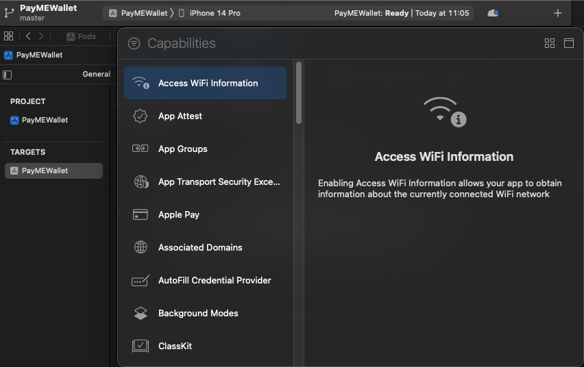

[Tiếng Việt](README.md) | **English**

# PayME Miniapp iOS SDK

An SDK for opening the PayME Miniapp (wallet, payments, deposit, withdraw, transfer, bill payments, eKYC) in your iOS app.

Current version: **0.16.0**. Install with [Swift Package Manager](#swift-package-manager-recommended) (recommended) or [CocoaPods](#cocoapods) from PayME's spec repo (CocoaPods trunk stops accepting new versions on 2 December 2026).

## Table of contents

1. [Requirements](#requirements)
2. [Installation](#installation): [Swift Package Manager](#swift-package-manager-recommended), [CocoaPods](#cocoapods), [manual](#manual-installation), [CocoaPods support roadmap](#cocoapods-support-roadmap)
3. [App configuration](#app-configuration)
4. [Quick start](#quick-start)
5. [identityToken](#identitytoken)
6. [API](#api)
7. [Error codes](#error-codes)
8. [Upgrading to 0.16.0](#upgrading-to-0160)
9. [Upgrading to 0.15.0](#upgrading-to-0150)
10. [Upgrading to 0.14.1](#upgrading-to-0141)
11. [Upgrading to 0.14.0](#upgrading-to-0140)
12. [Upgrading to 0.13.0](#upgrading-to-0130)
13. [Upgrading to 0.12.0](#upgrading-to-0120)
14. [Upgrading to 0.11.0](#upgrading-to-0110)
15. [Upgrading to 0.10.0](#upgrading-to-0100)
16. [Upgrading to 0.9.0](#upgrading-to-090)
17. [Upgrading from 0.7.x](#upgrading-from-07x)
18. [Support](#support)

## Requirements

- iOS 13.0 or later.
- Xcode 26.2 or later (the SDK is built with Swift 6.2.3; older Xcode versions cannot read it).
- Swift Package Manager, or CocoaPods (1.17.0 or later recommended).
- A server of yours that can call PayME's `identityToken` API (with the key set PayME issues for your server).

## Installation

Pick **one** way: Swift Package Manager or CocoaPods. Do not install the SDK both ways in the same app.

### Swift Package Manager (recommended)

In Xcode: **File → Add Package Dependencies…**, enter `https://github.com/PayME-Miniapp/payme-miniapp-spm.git`, choose **Up to Next Minor Version** from `0.16.0`, then add the `PayMEMiniApp` product to your app target. In a `Package.swift`:

```swift
.package(url: "https://github.com/PayME-Miniapp/payme-miniapp-spm.git", .upToNextMinor(from: "0.16.0")),
// in the target's dependencies:
.product(name: "PayMEMiniApp", package: "payme-miniapp-spm"),
```

- Use `.upToNextMinor(from:)`, not `from:`: for 0.x versions, `from:` also picks up new minor versions with breaking changes.
- The package brings KalapaEkycSDK 2.8.x and iProov 12.5.0 (`iProov/ios-spm`). If your app also uses iProov, it **must** use this same package; with `iProov/ios` Xcode fails to resolve with: `multiple similar targets 'iProov', 'iProovTargets' appear in package 'ios' and 'ios-spm'`.
- From 0.16.0 the SDK does not use Lottie: your app can use any Lottie version, installed any way.
- You need neither the spec repo, the `source` lines nor the CocoaPods `post_install` block.
- [App configuration](#app-configuration) (`Info.plist`, NFC capability) is the same as with CocoaPods.
- Example app: [`Examples/SPMSmoke`](https://github.com/PayME-Miniapp/payme-miniapp-spm/tree/main/Examples/SPMSmoke).

### CocoaPods

Add to your `Podfile`:

```ruby
# PayME's spec repo must come BEFORE the CDN: CocoaPods takes a pod from the first source that has it.
source 'https://github.com/PayME-Miniapp/Specs.git'
source 'https://cdn.cocoapods.org/'

# Your app's minimum iOS version (same as `platform :ios`). With Xcode 27 the minimum is '15.0'.
app_min_ios = '13.0'

platform :ios, app_min_ios

target 'YourApp' do
  pod 'PayME-Miniapp', '0.16.0'
end

post_install do |installer|
  installer.pods_project.targets.each do |target|
    target.build_configurations.each do |config|
      # Raise pods whose minimum iOS is lower than the app's
      if config.build_settings['IPHONEOS_DEPLOYMENT_TARGET'].to_f < app_min_ios.to_f
        config.build_settings['IPHONEOS_DEPLOYMENT_TARGET'] = app_min_ios
      end
    end
  end
end
```

```sh
pod install
```

- If your `Podfile` already has a `post_install`, merge the above into that block. The block is only needed when building with Xcode 27 (it raises the pods' minimum iOS).
- `use_frameworks!` is optional; no pod needs to be declared dynamic.
- Older versions (up to 0.10.1) exist in both PayME's spec repo and CocoaPods trunk, so `pod install` may print `Found multiple specifications for PayME-Miniapp`. It is harmless: the pod comes from the first source.
- Prefer not to add a `source`: point at the podspec directly, `pod 'PayME-Miniapp', :podspec => 'https://raw.githubusercontent.com/PayME-Miniapp/Specs/main/PayME-Miniapp/0.16.0/PayME-Miniapp.podspec'` (change the version in the URL when you upgrade).
- To upgrade the SDK: run `pod install --repo-update`.

### Manual installation

1. Download `PayMEMiniApp.xcframework.zip` from the matching [Release](https://github.com/PayME-Miniapp/native-ios/releases) and check its sha256 against `SHA256SUMS`.
2. Drag `PayMEMiniApp.xcframework` into your project and choose **Embed & Sign**.
3. Add the KalapaEkycSDK 2.8.x dependency yourself (with iProov). The simplest way is Swift Package Manager (`kalapa-ekyc-ios-sdk`, `iProov/ios-spm`).

### CocoaPods support roadmap

- Swift Package Manager is the main installation method from 0.15.0.
- CocoaPods through PayME's spec repo stays supported **at least until November 2027**: every new version still gets a podspec, with the same binary and sha256 as SPM.
- PayME will announce the end of CocoaPods support at least 6 months in advance.

## App configuration

Add to `Info.plist` (adjust the descriptions to your app):

```xml
<!-- Open banking apps during payment. Contact PayME for the full scheme list -->
<key>LSApplicationQueriesSchemes</key>
<array>
  <string>vcbpartner</string>
  <string>bidv.smartbanking.partner</string>
</array>
<key>NSCameraUsageDescription</key>
<string>The app uses the camera for identity verification and QR scanning</string>
<key>NSFaceIDUsageDescription</key>
<string>Use Face ID to confirm transactions</string>
<key>NSPhotoLibraryUsageDescription</key>
<string>The app needs photo library access to pick QR code images</string>
<key>NSPhotoLibraryAddUsageDescription</key>
<string>The app needs to save QR code images to your photo library</string>
<!-- Read the national ID card chip during eKYC -->
<key>NFCReaderUsageDescription</key>
<string>Read the national ID card chip for identity verification</string>
<key>com.apple.developer.nfc.readersession.iso7816.select-identifiers</key>
<array>
  <string>A0000002471001</string>
  <string>A0000002472001</string>
  <string>00000000000000</string>
</array>
```

In Xcode, open your app target → **Signing & Capabilities** → **+ Capability** → add **Near Field Communication Tag Reading**.



## Quick start

```swift
import UIKit
import PayMEMiniApp

final class WalletViewController: UIViewController, PayMEDelegate {
  private var payme: PayME!

  override func viewDidLoad() {
    super.viewDidLoad()
    // Sandbox: PayMEConfig.instance.env = .sbx; PayMEConfig.instance.setMode("miniapp_sandbox")
    payme = PayME(locale: .vi)
    payme.delegate = self
  }

  // identityToken is fetched from PayME by your server
  func openWallet(identityToken: String) {
    payme.open(with: .open(identityToken: identityToken), from: self, type: .modal)
  }

  func onResponse(action: PayMEAction, response: [String: Any]) { /* result */ }
  func onError(action: PayMEAction, error: PayMEError) { /* see Error codes */ }
}
```

## identityToken

`identityToken` is a string PayME issues for each of your users. Your app passes it every time it opens the Miniapp.

1. Your app calls your server.
2. Your server calls PayME's `token-init` API (`POST /be/ewallet/sdk/token-init`) with the user's information (contact PayME for the API docs). Never call this API from the app.
3. Your app passes the returned `identityToken` to `open`, `getBalance` or `getAccountInformation`.

| Action / function | `identityToken` |
| --- | --- |
| `.payment` | Optional. With it, the user can pay with the PayME wallet; without it, they pay as a guest (card, QR) |
| All other actions, `getBalance`, `getAccountInformation` | Required |

- The string is valid for 15 minutes and can be reused within that time.
- Empty: `onError` returns `IDENTITY_TOKEN_REQUIRED` and the Miniapp does not open.
- Wrong or expired: `onError` returns `401` (the Miniapp closes if open). Get a new string and call again.
- Keep the string in memory only: do not store it, log it, or put it in a URL.

## API

Call every function on the main thread. Results and errors come back through `PayMEDelegate`, also on the main thread.

### Initialization

```swift
PayME(locale: .vi)
```

| Parameter | Description |
| --- | --- |
| `locale` | `.vi` (default) or `.en` |

- Your app does not pass any key: the SDK has it built in.
- Keep the `PayME` object alive while you use the Miniapp (for example as a view controller property). You do not need to display it yourself.
- `delegate` is a strong reference. If the delegate also holds `PayME`, you get a retain cycle: set `payme.delegate = nil` when done, or use an intermediate object.
- The SDK's `Locale` and `Environment` clash with `Foundation.Locale` and `SwiftUI.Environment`. Use the short form (`.vi`, `.sbx`) or write `PayMEMiniApp.Locale`.

### PayMEConfig

Shared configuration via `PayMEConfig.instance`. Set it before calling `open`, `getBalance` or `getAccountInformation`.

| Property / function | Description |
| --- | --- |
| `env` | `.prod` (default) or `.sbx` (sandbox) |
| `setMode(_:)` | Defaults to `"miniapp_product"`. For sandbox, use `"miniapp_sandbox"` |
| `theme` | Colors of the eKYC camera screens: `Theme(primary:background:textPrimary:)` |
| `setDebugMode(_:)` | Turns on SDK logs during development. Turn it off in release builds |

### open

```swift
payme.open(with: PayMEOpeningParam, from: UIViewController?, type: PayMEOpeningType?)
```

- `from`: the view controller on screen. The SDK presents the Miniapp from it.
- `type`: `.screen` (full screen, default) or `.modal` (slides up from the bottom).
- Use `from: nil` only when `PayME` is already inside a `UINavigationController`: the SDK pushes the Miniapp onto that navigation and ignores `type`.

| Factory | Purpose | `data` |
| --- | --- | --- |
| `.open(identityToken:)` | Wallet home (opens the linking flow if not linked yet) | None |
| `.kyc(identityToken:)` | Identity verification (eKYC) | None |
| `.kalapaKYC(identityToken:)` | Identity verification via Kalapa (with NFC chip reading) | None |
| `.pay(identityToken:data:)` | Pay for your order | [`PayMEPaymentParam`](#paymepaymentparam-pay) |
| `.payment(identityToken:data:)` | Pay a transaction created via the PayME API | [`PayMEPaymentDirectParam`](#paymepaymentdirectparam-payment) |
| `.transferQR(identityToken:data:)` | Transfer to a bank account | [`PayMETransferQRParam`](#paymetransferqrparam-transferqr) |
| `.service(identityToken:data:)` | Bill payments (electricity, water, cards…) | [`PayMEServiceParam`](#paymeserviceparam-service) |
| `.deposit`, `.withdraw`, `.transfer` `(identityToken:data:)` | Deposit, withdraw, transfer | [`PayMEPayParam`](#paymepayparam-deposit-withdraw-transfer), optional |

```swift
payme.open(
  with: .pay(
    identityToken: identityToken,
    data: PayMEPaymentParam(amount: 10_000, transactionId: "ORDER_123", note: "Order 123")),
  from: self, type: .modal)
payme.open(with: .payment(data: PayMEPaymentDirectParam(transaction: "<TRANSACTION>")), from: self) // guest
payme.open(with: .service(identityToken: identityToken, data: PayMEServiceParam(service: "POWE")), from: self)
payme.open(with: .deposit(identityToken: identityToken, data: PayMEPayParam(amount: 50_000)), from: self)
```

`amount` is an integer in VND. Every `data` parameter below also has two optional fields: `extraData` (`[String: Any]`, your own data, returned when the transaction succeeds) and `isShowResult` (show PayME's result screen, default `true`).

#### PayMEPaymentParam (pay)

| Field | Required | Description |
| --- | --- | --- |
| `amount` | Yes | Amount |
| `transactionId` | Yes | Your transaction ID |
| `note` | No | Note |
| `ipnUrl` | No | URL that receives transaction status notifications |

#### PayMEPaymentDirectParam (payment)

| Field | Required | Description |
| --- | --- | --- |
| `transaction` | Yes | Transaction ID PayME returned when you created the transaction |

#### PayMETransferQRParam (transferQR)

| Field | Required | Description |
| --- | --- | --- |
| `amount` | Yes | Amount (`0` lets the user enter it) |
| `bankNumber` | Yes | Receiving account or card number |
| `swiftCode` | Yes | SWIFT code of the receiving bank |
| `cardHolder` | Yes | Account holder name |
| `note` | No | Note |
| `partnerTransaction` | No | Your transaction ID |

#### PayMEServiceParam (service)

| Field | Required | Description |
| --- | --- | --- |
| `service` | Yes | `POWE` (electricity), `WATE` (water), `ADSL` (internet), `TIVI` (TV), `PPMB` (postpaid), `MOBILE_CARD` (phone card), `MOBILE_TOPUP` (phone top-up), `GAME_CARD` (game card) |
| `isBackToApp` | No | Return to your app when done (default `true`) |

#### PayMEPayParam (deposit, withdraw, transfer)

| Field | Required | Description |
| --- | --- | --- |
| `amount` | No | Prefilled amount (default `0`: the user enters it) |
| `description` | No | Transaction description |
| `isBackToApp` | No | Return to your app when done (default `true`) |

### getBalance, getAccountInformation

```swift
payme.getBalance(identityToken: identityToken)
payme.getAccountInformation(identityToken: identityToken)
```

Results come back through `onResponse`:

- `.GetBalance`: `linked` (whether the wallet is linked), `balance` (`Int64`, present when `linked` is `true`).
- `.GetAccountInfo`: wallet account information, always includes `accountId`.

### setLanguage, close

- `setLanguage(of: .vi | .en)`: changes the language, applied the next time the Miniapp opens.
- `close()`: closes the open Miniapp (even while it is downloading an update) and reports `USER_CANCEL`. Does nothing if no Miniapp is open.

### PayMEDelegate

```swift
func onResponse(action: PayMEAction, response: [String: Any])
func onError(action: PayMEAction, error: PayMEError)
```

| Event | Content | When |
| --- | --- | --- |
| `onResponse` | `action`, `response` | A transaction result is available (check `state` below), or a `getBalance` / `getAccountInformation` result arrives |
| `onError` | `action`, `error.code`, `error.description` | An error occurs or the user closes the Miniapp |

**Transaction results.** For `PAY`, `PAYMENT`, `TRANSFER_QR`, `SERVICE`, `DEPOSIT`, `WITHDRAW` and `TRANSFER`, the Miniapp sends `onResponse` when the user leaves the result screen, **whatever the transaction state**, not only on success. Always check `state`, and confirm on your server (via `ipnUrl` or a lookup API) before you deliver:

| Field | Meaning |
| --- | --- |
| `state` | `SUCCEEDED` succeeded · `PENDING` still processing (check again later) · `FAILED` failed |
| `transaction` | PayME transaction id |
| `partnerTransaction` | Your transaction id (the value you passed when opening) |
| `amount`, `amountText` | Amount (integer VND) and the formatted string |
| `method`, `createdAt` | Payment method, creation time |
| `extraData` | Your own data, as passed |

The Miniapp also sends `onResponse` with action `GET_BALANCE` on its own when the balance changes (not from your `getBalance` call).

```swift
func onResponse(action: PayMEAction, response: [String: Any]) {
  guard action == .Pay else { return }
  switch response["state"] as? String {
  case "SUCCEEDED": break // paid
  case "PENDING": break // processing: check on your server
  default: break // failed
  }
}
```

- `error.description` is localized, ready to display.
- With Swift 6 language mode: declare `@preconcurrency PayMEDelegate`.
- Always confirm the final transaction status on your server (via `ipnUrl` or the PayME API), not only through `onResponse`.

### Opening and closing the Miniapp

- Only one Miniapp can be open at a time. Calling `open` while one is open returns `MINIAPP_ALREADY_OPEN`.
- When Miniapp closes, you get its result exactly once: `onResponse`, `onError`, or `USER_CANCEL` when the user closes it. You can open again right inside that callback.
- Presented (`from: viewController`): the SDK closes the Miniapp itself, then calls the callback. You do not need to dismiss.
- Pushed (`from: nil`), when the Miniapp closes itself (the user taps close, or a transaction finishes): if the navigation is presented, the SDK dismisses it; otherwise you pop in the callback.
- After you call `close()`, the SDK removes the Miniapp in both modes. Do not pop again in the `USER_CANCEL` callback.

## Error codes

| `code` | Meaning | What to do |
| --- | --- | --- |
| `401` | `identityToken` is wrong or expired | Get a new `identityToken` and call again |
| `IDENTITY_TOKEN_REQUIRED` | `identityToken` is missing | Pass an `identityToken` |
| `USER_CANCEL` | The user closed the Miniapp, or you called `close()` | Not an error |
| `SYSTEM_CANCEL` | The SDK could not start the Miniapp on the device | Open again; contact PayME if it repeats |
| `MINIAPP_ALREADY_OPEN` | A Miniapp is already open | Wait for it to close, or call `close()` first |
| `MINIAPP_CANNOT_PRESENT` | Nowhere to show the Miniapp (`from: nil` while `PayME` is not inside a `UINavigationController`) | Pass `from` as the view controller on screen |
| Other codes | Network, server or business errors | Show `description`, retry; contact PayME if it repeats |

## Upgrading to 0.16.0

- The SDK **no longer uses Lottie**; its animations (face-capture guides, patch update) play from APNG images bundled in the SDK. The SDK now pulls in only `KalapaEkycSDK` (with iProov).
- CocoaPods: if your app uses `lottie-ios` itself, declare it in your `Podfile`. Drop the `BUILD_LIBRARY_FOR_DISTRIBUTION` line from `post_install` and the `$dynamic_framework` list (if any); `use_frameworks!` is optional.
- SPM: use `.upToNextMinor(from: "0.16.0")`. Your app can use any Lottie version, installed any way (including `airbnb/lottie-ios`).
- No SDK API changes. The iOS 15–17 note of 0.14.0 still applies.

## Upgrading to 0.15.0

- **Swift Package Manager is final** (no longer a preview) and is the recommended installation: see [Installation](#installation). Use `.upToNextMinor(from: "0.15.0")`.
- The SDK's internal web server (serving the Miniapp at `http://localhost:29398`) now uses Network.framework. The SDK **no longer pulls in `GCDWebServer`**: if your app uses that pod itself, declare it in your `Podfile`; projects using `$dynamic_framework` should drop `'GCDWebServer'` from the list. Apps that embed GCDWebServer can now install the SDK with SPM.
- No SDK API changes. A few behaviours of the internal web server changed; they only matter if your app sends its own requests to `localhost:29398`:
  - methods other than GET/HEAD return 405 with `Allow: GET, HEAD` (was 501);
  - an unsatisfiable range returns 416 with `Content-Range: bytes */<size>` (was 404);
  - a malformed request returns 400 (was 500); a request head larger than 1 MiB returns 431;
  - a request head not received within 15 seconds gets 408 and the connection is closed;
  - the two `Access-Control-Request-*` response headers are gone; the `Server` header is `PayMEMiniApp`.
- The iOS 15–17 note of 0.14.0 still applies.

## Upgrading to 0.14.1

- Same code as 0.14.0: no SDK API or behaviour changes, only the version number. CocoaPods dependencies are unchanged.
- CocoaPods: change the pod to `'0.14.1'`, then run `pod install --repo-update`.
- New: Swift Package Manager (preview), final from 0.15.0.
- The iOS 15–17 note of 0.14.0 still applies.

## Upgrading to 0.14.0

- The SDK uses the system crypto (CommonCrypto, Security, CryptoKit) and no longer pulls in `CryptoSwift` or `SwiftyRSA`. If your app uses those pods itself, declare them in your `Podfile`; projects using `$dynamic_framework` should drop `'CryptoSwift'` and `'SwiftyRSA'` from the list.
- No SDK API changes.
- **Note:** this release was tested on iOS 18.6, 27.2 and a device on iOS 27.2.1, **not on iOS 15–17**. If your app supports those versions, try the wallet and payment flows before upgrading.

## Upgrading to 0.13.0

- The SDK no longer pulls in `SwiftyJSON`. If your app uses that pod itself, declare it in your `Podfile`; projects using `$dynamic_framework` should drop `'SwiftyJSON'` from the list.
- No SDK API changes.

## Upgrading to 0.12.0

Breaking changes (announced in 0.11.0):

- `PayMECombine.notificationSubject` is removed: use `combine.send(notification: userInfo)`.
- `Console` and `BiometricAuthenication` are no longer public.
- The SDK no longer pulls in `ZIPFoundation`, `NSLogger` or `Mixpanel-swift` (with `MixpanelSwiftCommon`, `jsonlogic`, `json-enum`). If your app uses those pods itself, declare them in your `Podfile`; projects using `$dynamic_framework` should drop those names from the list.
- `import PayMEMiniApp` no longer re-exports third-party modules (`SwiftyJSON`, `CryptoSwift`, …) or their extensions: import those modules directly if you use them.
- The SDK no longer sends events to Mixpanel.
- The SDK ships a Privacy Manifest (`PrivacyInfo.xcprivacy`). When you archive, Xcode merges it into your app's privacy report (Organizer → right-click the archive → Generate Privacy Report); use that report for your App Store privacy labels.

## Upgrading to 0.11.0

- Add the two `source` lines at the top of your `Podfile` as in [Installation](#installation), then run `pod install --repo-update`. No code change.
- Apps that forward push notifications to the Miniapp: replace `combine.notificationSubject.send(JSON(userInfo))` with `combine.send(notification: userInfo)`. `notificationSubject` will be removed in 0.12.0.
- From 0.12.0, `Console` and `BiometricAuthenication` are no longer public, and the SDK no longer pulls in `ZIPFoundation`, `NSLogger` or `Mixpanel-swift` (`SwiftyJSON` from 0.13.0): if your app uses those pods itself, declare them in your `Podfile`.

## Upgrading to 0.10.0

Picking a phone number for top-up uses the system contact picker, so the SDK no longer reads contacts. You can remove `NSContactsUsageDescription` from `Info.plist` if your app declares it only for the SDK.

## Upgrading to 0.9.0

Replace `PayME(key: PayMEKey(...), locale:)` with `PayME(locale:)`. The old initializer still works (deprecated) and ignores the key.

## Upgrading from 0.7.x

0.8.x replaces the phone number with `identityToken` and is not backward compatible. The `data` structs, `PayMEDelegate` and `PayMEError` are unchanged.

| 0.7.x | 0.8.x |
| --- | --- |
| `.open(phone:)`, `.kyc(phone:)`, `.kalapaKYC(phone:)` | `.open(identityToken:)`, `.kyc(identityToken:)`, `.kalapaKYC(identityToken:)` |
| `.pay(phone:data:)` and other actions with `data` | `.pay(identityToken:data:)`, … |
| `.payment(phone:data:)` | `.payment(identityToken:data:)`, `identityToken` optional |
| `PayMEOpeningParam(action:phone:data:)` | Removed, use the factories |
| `getBalance(of:)`, `getAccountInformation(of:)` | `getBalance(identityToken:)`, `getAccountInformation(identityToken:)` |

1. Server: integrate the `token-init` API (contact PayME).
2. Add the two `source` lines (see [Installation](#installation)), change the pod to `'0.16.0'`, then run `pod install --repo-update`.
3. Replace every `phone` with `identityToken` as in the table above.
4. Handle the `401` and `IDENTITY_TOKEN_REQUIRED` errors. `linked: false` from `getBalance` now only means the user has not linked a wallet.
5. Build with Xcode 26.2 or later.

## Support

PayME Technology Corporation, email [hotro@payme.vn](mailto:hotro@payme.vn). For the server key set, the sandbox environment, the `token-init` API docs and the `PAYMENT` transaction creation API: contact PayME.

Release notes: [GitHub Releases](https://github.com/PayME-Miniapp/native-ios/releases).
